# Site Reliability Platform

Demo

[Watch the Full SRE Platform Demonstration on LinkedIn](https://lnkd.in/p/gbGvvdAN)

A walkthrough of my AWS Site Reliability Platform demonstrating:

* Automated CI/CD: Jenkins Build #5 successfully tested, built, and deployed a Dockerized FastAPI application through Amazon ECR and AWS Systems Manager to EC2.
* Deployment Reliability: Immutable image verification, container health checks, restricted IAM permissions, and Nginx cutover.
* Monitoring & Alerting: Custom CloudWatch metrics, SNS email notifications, and external Datadog Synthetic Monitoring.
* Failure Injection: Simulated an application outage and verified CloudWatch transitioned to ALARM and Datadog to ALERT.
* Incident Recovery: Manually restored the application, confirmed HTTP 200 health checks, and verified recovery notifications.

Outcome: Successfully demonstrated end-to-end automated deployment, failure detection, alert delivery, and manual incident recovery. Automated deployment rollback safeguards were also implemented and unit-tested, but not live-tested.

## Architecture

```text
Jenkins -> Docker -> ECR -> SSM SREPlatformDeploy -> EC2 -> Nginx :80
                                                              |
                                                              v
                                            container 127.0.0.1:18001
                                                              |
                                                              v
                                            Uvicorn :8000 inside the container
                                                              |
                                                              v
                                                    FastAPI /health
```

While the instance was running, `sre-service` listened on `127.0.0.1:8000`. Nginx did not proxy to it. That process remained available for manual rollback.

Monitoring and alerting:

```text
Python synthetic monitor
   |
   v
CloudWatch custom metrics
   |
   v
CloudWatch alarm
   |
   v
Amazon SNS
   |
   v
Email notification
```

External monitoring (healthy OK, then OK → ALERT → OK; see [Datadog External Monitoring](#datadog-external-monitoring)):

```text
Datadog Synthetic HTTP test (AWS Ohio location, every 15 minutes)
   |
   v
Public endpoint on the EC2 instance: GET /health
```

While the instance was running, the container's Uvicorn listened on localhost inside that container. Nginx provided the public HTTP entry point on port 80 and proxied to `127.0.0.1:18001`. `deploy/sre-monitor.service` checked that Nginx path and published `Availability`, `LatencyMs`, and `Failures`. After the demonstration the EC2 instance is stopped and the Datadog synthetic test is paused.

## What Runs Where

**Deployed on AWS (the EC2 instance and AWS services)**

- FastAPI in a Docker container, published only on `127.0.0.1:18001`, behind Nginx on port 80
- systemd unit `sre-service` on `127.0.0.1:8000`, kept for manual rollback and not used as the Nginx upstream
- `deploy/sre-monitor.service`, installed and enabled; it was active during the demonstration
- CloudWatch custom metrics, dashboard, and alarm; SNS email notification; EC2 IAM role
- `/usr/local/sbin/sre-platform-deploy`, installed from `deploy/ec2_deploy.py`
- SSM document `SREPlatformDeploy` version 1

This deployment was built and configured by hand. It is **not** provisioned or configured by Terraform or Ansible. Jenkins Build #5 of the temporary job `sre-platform-ci-ecr-test` published the image and sent the verified digest through `SREPlatformDeploy`. Nginx proxied to `127.0.0.1:18001`. The previous container was stopped and kept. The instance is now stopped. See `deploy/ec2-deployment.md`.

**AWS, separate from the EC2 application**

- A private ECR repository named `sre-platform` in `us-east-2`. Jenkins publishes `linux/amd64` images to it. The digest verified on the instance is `sha256:6951edc16cb827ad3c13814eaa9fb490ffb9f1402453e7ccad31de376ac48e8e`.

**External service**

- A Datadog Synthetic HTTP test that probed the EC2 endpoint from outside AWS. It is configured in the Datadog UI and is paused after the demonstration.

**Local demonstrations (not deployed to AWS)**

- **Docker:** the FastAPI service can also be built and run on a local machine. The EC2 container is a separate `linux/amd64` image published by Jenkins.
- **Jenkins:** the controller runs locally. Build #5 tested the service, checked a temporary container, published the image, and deployed that digest to EC2.
- **Ansible:** a playbook configures Nginx in a throwaway local Ubuntu container, not on EC2.
- **Terraform:** a small demo created, verified, and destroyed one isolated security group. It does not manage the EC2 instance.

## Technologies

AWS deployment:

- Python
- FastAPI
- Uvicorn
- Linux / Ubuntu
- systemd
- Nginx
- AWS EC2
- Amazon CloudWatch
- Amazon SNS
- boto3
- Git / GitHub

Local demonstrations:

- Docker
- Jenkins LTS (with a Docker-in-Docker sidecar) publishing to Amazon ECR
- Terraform
- Ansible

External monitoring:

- Datadog Synthetic Monitoring

## Service

`service/main.py` exposes a deliberately simple health endpoint:

```text
GET /health
```

Healthy response:

```json
{"status":"healthy"}
```

Keeping the application small makes the reliability behavior easy to observe and test.

## Process Management

Uvicorn runs as a systemd-managed service using `deploy/sre-service.service`.

The service:

- runs as the Ubuntu user
- uses the project's Python virtual environment
- binds Uvicorn to `127.0.0.1:8000`
- starts automatically during normal system boot
- is configured with `Restart=on-failure`

Uvicorn is not directly exposed to the internet.

## Nginx Reverse Proxy

Nginx provides the public HTTP entry point:

```text
Client -> Nginx :80 -> container 127.0.0.1:18001 -> Uvicorn :8000 -> FastAPI
```

While the instance was running, requests received by Nginx were forwarded over localhost to the container Jenkins Build #5 placed in service. The instance is now stopped. `deploy/nginx.conf` in git still points at port 8000. The host script edits the live site file and does not copy that git file onto the instance.

## Synthetic Monitoring

`monitor/monitor.py` continuously checks the health endpoint. On the instance, `deploy/sre-monitor.service` was installed, active, and enabled during the demonstration. It runs as the Ubuntu user and checks `http://127.0.0.1/health`, which is Nginx. CloudWatch therefore followed the container Nginx was serving. The unit does not set access keys. The monitor's own default URL is still `127.0.0.1:8000`, the systemd process. The unit overrides that default. The instance is now stopped.

The monitor:

- performs HTTP health checks
- measures response duration
- records structured JSON events
- tracks consecutive failures
- retries failed checks
- alerts after three consecutive failures
- limits repeated alerts with a cooldown
- detects recovery and resets the failure counter

## CloudWatch Observability

`deploy/sre-monitor.service` enables CloudWatch publishing. The monitor publishes three custom metrics to the `SREPlatform` namespace from the Nginx health check:

- `Availability` (`1` when the check is healthy, otherwise `0`)
- `LatencyMs` (check duration in milliseconds)
- `Failures` (`1` when the check fails, otherwise `0`)

The EC2 instance uses an IAM role for AWS access rather than hard-coded AWS credentials.

A CloudWatch dashboard provides centralized visibility into these metrics.

## Alerting

A CloudWatch alarm monitors the failure metric.

The alert path is:

```text
Synthetic monitor
      |
      v
CloudWatch Failures metric
      |
      v
CloudWatch alarm
      |
      v
Amazon SNS
      |
      v
Email notification
```

This path was tested end-to-end during a controlled application outage.

## Automatic Process Recovery Test

Process-level recovery was tested separately from the controlled outage test.

The Uvicorn process was forcibly terminated with SIGKILL to simulate an unexpected process crash. Because `sre-service` is configured with `Restart=on-failure`, systemd detected the failed process and automatically started a replacement process after the configured restart delay.

After the restart:

- `sre-service` returned to the active state
- Uvicorn was running again
- `/health` returned HTTP 200

This test demonstrates automatic process recovery. It is separate from the controlled outage test below, where `systemctl stop` intentionally keeps the service stopped until manual restoration.

Boot persistence was also verified separately by restarting the EC2 instance and confirming that the enabled systemd service started during normal boot and `/health` returned HTTP 200.
## Controlled Failure Test

This outage is historical. Nginx proxied to `sre-service` at the time. Current public traffic goes to the Docker container on `127.0.0.1:18001`. The results below are unchanged.

The deployed system was tested by deliberately creating an application outage.

### Healthy State

Before failure injection:

- `sre-service` was active
- Nginx successfully proxied `/health`
- the endpoint returned HTTP 200
- the monitor reported successful checks
- healthy metrics were published to CloudWatch

### Failure Injection

The application service was intentionally stopped:

```bash
sudo systemctl stop sre-service
```

During the outage:

- the health endpoint became unavailable
- the monitor detected failed checks
- the consecutive failure count increased
- the local threshold alert fired after three consecutive failures
- failure metrics were published to CloudWatch
- the CloudWatch alarm entered its alarm state
- SNS delivered the alarm email

### Recovery

The service was restored:

```bash
sudo systemctl start sre-service
```

After restoration:

- systemd reported the service active
- `/health` returned HTTP 200 through Nginx
- the monitor detected recovery
- the consecutive failure count reset to zero
- healthy CloudWatch measurements resumed

### Test Evidence

The controlled outage produced a sustained failure signal in CloudWatch, triggered the configured failure alarm, and delivered an SNS email notification.

#### CloudWatch failure alarm

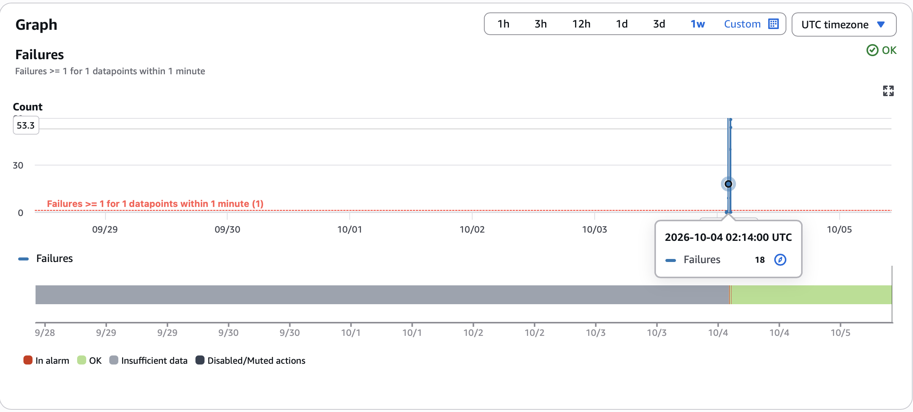

#### SNS alarm notification

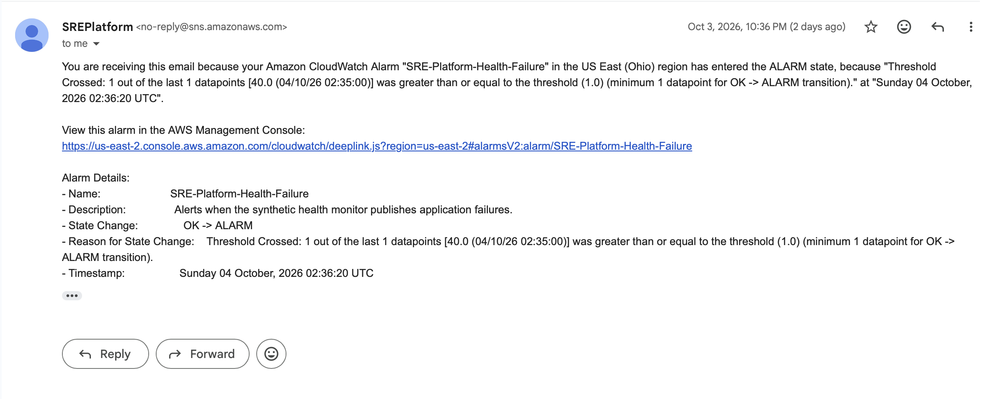

Detailed failure-test notes are available in `incidents/failure-tests.md`.

## Docker

*Local image build. Jenkins publishes a separate image and Build #5 pulled that digest onto EC2. The systemd service was still running during that deployment. The instance is now stopped.*

`Dockerfile` builds an image of the FastAPI service: `python:3.12-slim`, a non-root user, only `service/` and
`requirements.txt` copied in, Uvicorn on `0.0.0.0:8000`, and a Python `urllib` `HEALTHCHECK` against `/health`.
`.dockerignore` keeps `.git`, virtual environments, `.env` files, keys, logs, and Terraform state out of the build.

Verified locally: the image built, the container's health status became `healthy`, the container ran as a
non-root user, and `GET /health` returned HTTP 200 with `{"status":"healthy"}`. A plain local `docker build` does not
push anywhere. Jenkins publishes a separate `linux/amd64` image to ECR.

## Jenkins CI

*Local Jenkins. It publishes images to a private ECR repository and Build #5 deployed the verified digest through SSM. See `deploy/ec2-deployment.md`.*

`Jenkinsfile` and `jenkins/` run Jenkins LTS in Docker, bound to `127.0.0.1:8080`, with a TLS Docker-in-Docker
sidecar. The host Docker socket is not mounted, and the controller is not privileged. Short-lived AWS credentials
are loaded into an in-memory directory for a build and removed when the build ends. No access keys are stored in Git.

The pipeline keeps the original local stages, then publishes and deploys. In order: Checkout, Install Dependencies, Test
(the 4 unit tests), Build Image, Deploy Temporary Container, Verify Health (`GET /health` must return HTTP 200),
Verify AWS Deployment Role (`assumed-role/sre-jenkins-deploy-role`), Publish Image to ECR (`linux/amd64`, tagged
with the full commit SHA), Verify Image in ECR (digest, architecture, and revision label), Deploy to EC2
(`SREPlatformDeploy` version 1, that verified digest only), then cleanup.
Nothing is published unless the tests and the local health check pass. Nothing is sent to SSM unless the ECR
verify stage recorded the digest. An existing immutable tag is reused only
when its digest matches a publish record or an operator-supplied digest. Images are never overwritten or deleted
by the pipeline.

**Build #2: SUCCESS** on job `sre-platform-ci` (local stages only, before ECR publishing).

**Build #4: SUCCESS** on the temporary job `sre-platform-ci-ecr-test`, which built an isolated snapshot of this
work (`110adbe1f0cdd3e355486b3dd415f5dea97a06c5`). That snapshot is not a commit in this repository. The 4 unit
tests passed, the temporary container became healthy and returned HTTP 200, and ECR received
`sre-platform:110adbe1f0cdd3e355486b3dd415f5dea97a06c5` with digest
`sha256:5f6ab0e1caf0bc49ff1b9cb6cc14885a10b60847b8e4096405b00d7eee70755d`. The verify stage recorded
`linux/amd64` and a matching source revision label. A later read-only `DescribeImages` returned that same digest.
Credentials were removed at the end, and the temporary container was removed. The earlier image
`43eb11cef129969bf70df72267950fb0b57ceac5` was left unchanged. EC2 was not modified. Job `sre-platform-ci` was not
used for this build and still has its original history.

**Build #5: SUCCESS** on the same temporary job. It is the verified Jenkins → Docker → ECR → SSM → EC2 → Nginx
run. The source snapshot is `1654be9a8e0e08ce4c480b01f18b41b62da88ed4`, kept in the Jenkins test repository and
not a commit in this project. The 4 unit tests passed. ECR received
`sha256:6951edc16cb827ad3c13814eaa9fb490ffb9f1402453e7ccad31de376ac48e8e`. SSM command
`a4a8d4f3-36a7-418b-80c1-b9c8382a554e` finished Success with exit 0. Nginx switched to `127.0.0.1:18001`.
Container `sre-platform-6951edc16cb8` passed its health check, and `/health` through Nginx returned HTTP 200.
The previous container, `sre-platform-candidate`, was stopped and kept. Credentials were removed at the end.
Job `sre-platform-ci` was not used.

That build is a successful cutover. The deploy script's automatic rollback is implemented and covered by
`deploy/test_ec2_deploy.py`. Build #5 did not exercise a failed cutover on the instance. The recorded
CloudWatch outage and recovery used a manual stop and start of `sre-service`.

Limits: publishing needs a short-lived role session loaded on the Mac before each build, so it is not unattended.
The pipeline is not triggered by GitHub. It relies on a lab-only Jenkins setting (`ALLOW_LOCAL_CHECKOUT`) that
must not be used on a shared Jenkins. See `jenkins/README.md`.

## Terraform

*Small demonstration. Terraform does not manage the EC2 instance.*

`terraform/demo/` defines one resource: an isolated security group named `sre-terraform-demo` in an existing
VPC in `us-east-2`, with no inbound or outbound rules and nothing attached to it.

It was planned and applied once (1 resource added), verified with the AWS CLI (name, VPC, tags, and zero rules),
checked for drift (no differences), and later destroyed. After the destroy, `terraform state list` was empty
and AWS returned `InvalidGroup.NotFound` for the group. The existing EC2 instance, security groups,
Nginx, systemd, CloudWatch, and SNS were not managed, imported, or modified. State is local and not committed.
See `terraform/demo/README.md`.

## Ansible

*Local demonstration. The playbook does not configure the EC2 instance.*

`ansible/` contains an inventory, a playbook, and a template that install and configure Nginx on a throwaway,
unprivileged Ubuntu 24.04 container, reached with `docker exec` and published only on `127.0.0.1:18080`.

Verified: the first run reported `changed=4`, the second run reported `changed=0`, `nginx -t` passed, and the
endpoint returned HTTP 200. It uses its own demo Nginx config and does not touch `deploy/nginx.conf` or
`deploy/sre-service.service`. See `ansible/README.md`.

## Datadog External Monitoring

*External SaaS check of the AWS deployment, configured in the Datadog UI.*

A Datadog Synthetic HTTP test sends `GET /health` to the EC2 application's public endpoint every 15 minutes
from one AWS Ohio location. Its assertions are status code `200`, response time below 2000 ms, and
`Content-Type: application/json`.

**Verified:** two executions (one scheduled, one manual) passed, with HTTP 200 and response times of about
7 to 10 ms. The Datadog monitor status for those runs was OK. Controlled manual failure injection then
produced failed HTTP checks. After multiple failed checks the monitor went from OK to ALERT. Manual
application recovery followed, and the monitor returned from ALERT to OK. While the instance was running,
Nginx served that endpoint from the container on `127.0.0.1:18001`. Stopping `sre-service` does not fail it.
The exact injection command is not recorded.

**Not recorded:** delivery of a Datadog notification message. Manual recovery of the application is separate
from the deploy script's automatic rollback, which has not been exercised on the instance. The synthetic test
is paused, and the EC2 instance is stopped.
See `docs/datadog-monitoring.md` for the comparison with the Python monitor and CloudWatch, and for
the full list of limitations.

## Running Locally

Create a virtual environment:

```bash
python3 -m venv .venv
source .venv/bin/activate
```

Install dependencies:

```bash
python -m pip install -r requirements.txt
```

Start the FastAPI service:

```bash
python -m uvicorn service.main:app --host 127.0.0.1 --port 8000
```

Verify the endpoint:

```bash
curl -i http://127.0.0.1:8000/health
```

Run the synthetic monitor:

```bash
python monitor/monitor.py --url http://127.0.0.1:8000/health
```

On the AWS deployment, CloudWatch publishing can be enabled with:

```bash
python monitor/monitor.py --url http://127.0.0.1/health --cloudwatch
```

Run the unit tests:

```bash
python -m unittest discover -s tests -v
```

Build and run the container locally (bound to loopback only). Port 18000 in this local example is not the EC2 upstream:

```bash
docker build -t sre-platform:demo .
docker run -d --name sre-platform-demo -p 127.0.0.1:18000:8000 sre-platform:demo
curl -i http://127.0.0.1:18000/health
docker rm -f sre-platform-demo
```

The Jenkins, Terraform, and Ansible demonstrations have their own instructions in `jenkins/README.md`,
`terraform/demo/README.md`, and `ansible/README.md`.

## Repository Structure

```text
site-reliability-platform/
├── service/
│   └── main.py
├── monitor/
│   └── monitor.py
├── tests/
│   └── test_monitor.py
├── deploy/                  # EC2 deployment files
│   ├── nginx.conf
│   ├── sre-service.service
│   ├── sre-monitor.service  # installed unit; checks Nginx and publishes CloudWatch metrics
│   ├── ec2_deploy.py        # installed on the instance as /usr/local/sbin/sre-platform-deploy
│   ├── ec2-deployment.md
│   ├── test_ec2_deploy.py
│   └── ssm/SREPlatformDeploy.json  # source for registered document version 1
├── Dockerfile               # local container image of the service
├── .dockerignore
├── Jenkinsfile              # test, local health check, publish to ECR, deploy through SSM
├── jenkins/                 # local Jenkins, credential handoff, ECR and SSM helpers
│   ├── Dockerfile
│   ├── docker-compose.yml
│   ├── aws-creds-handoff.sh
│   ├── ecr_publish_tool.py
│   ├── ssm_deploy_tool.py
│   └── README.md
├── terraform/deployment/    # private ECR repository (does not manage EC2)
├── terraform/demo/          # isolated security group demo
│   ├── *.tf
│   ├── .terraform.lock.hcl
│   ├── terraform.tfvars.example
│   └── README.md
├── ansible/                 # Nginx configuration demo on a local container
│   ├── inventory.ini
│   ├── playbook.yml
│   ├── templates/nginx.conf.j2
│   └── README.md
├── incidents/
│   └── failure-tests.md
├── docs/
│   ├── images/
│   ├── project-explained.md
│   └── datadog-monitoring.md
├── requirements.txt
└── README.md
```

## Final demonstration status

| Result | Status |
| --- | --- |
| Jenkins Build #5 | SUCCESS |
| Jenkins → ECR → SSM → EC2 | VERIFIED |
| Docker and Nginx deployment | VERIFIED. Nginx proxied to `127.0.0.1:18001` |
| CloudWatch metrics and alarm | VERIFIED |
| Datadog failure detection and recovery | VERIFIED. OK, then OK → ALERT, then ALERT → OK |
| Live automated deployment rollback | Implemented and unit-tested. Not verified on the instance |
| EC2 after the demonstration | STOPPED |
| Datadog synthetic test after the demonstration | PAUSED |

Automated CI/CD deployment, automated failure detection, and manual runtime recovery are separate. The deploy script can roll back a failed cutover. That live path was not run.

## Project Scope

This is intentionally a small learning and portfolio project rather than a production-ready platform.

It demonstrates:

- AWS EC2 deployment
- Linux service management
- Nginx reverse proxying
- synthetic HTTP monitoring
- structured health-check logging
- failure thresholds and local alerting
- custom CloudWatch metrics
- CloudWatch dashboarding
- CloudWatch alarms
- SNS email notification
- controlled failure injection
- service restoration and recovery detection
- local containerization with Docker
- a local Jenkins pipeline that tests the service, checks a temporary container, publishes a `linux/amd64` image to a private ECR repository, and deploys the verified digest through SSM (Build #5)
- infrastructure as code with Terraform, limited to one isolated demo security group
- idempotent configuration management with Ansible on a local container
- an external Datadog synthetic check (OK, then OK → ALERT after failed HTTP checks, then ALERT → OK after manual recovery)

It does **not** currently:

- show a live run of the deploy script's automatic rollback (Build #5 was a successful cutover; rollback is implemented and unit-tested)
- manage the EC2 instance, its security groups, Nginx, systemd, CloudWatch, or SNS with Terraform
- configure the EC2 instance with Ansible
- record delivery of a Datadog notification message
- provide TLS, high availability, or centralized log aggregation
- keep the EC2 instance running or the Datadog test unpaused after the demonstration

The historical failure demonstration stopped and started `sre-service` by hand while Nginx still proxied to it. The on-host monitor detected that outage and the recovery, CloudWatch entered alarm, and SNS delivered email. A later controlled manual failure injection on the Docker path produced Datadog's OK → ALERT → OK transition. Neither demonstration was the deploy script's automatic rollback.

Potential improvements include managing the EC2 deployment with infrastructure as code and configuration management, a live exercise of automatic deploy rollback, tighter least-privilege IAM, TLS, centralized logging, a recorded Datadog notification delivery, and additional failure scenarios.

## Verified CI/CD Deployment & Incident Response

The following screenshots document the successful Jenkins Build #5 deployment and controlled failure-recovery demonstration.

### Automated Deployment

Jenkins successfully completed application testing, Docker image building, health verification, immutable ECR publishing, and EC2 deployment through AWS Systems Manager.

**Jenkins Build #5 — All stages successful**

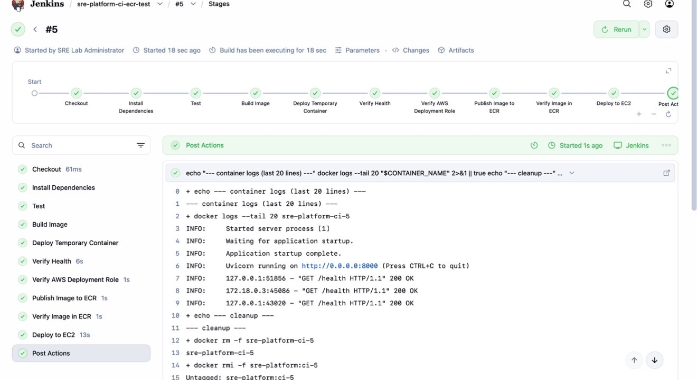

**Amazon ECR — Verified immutable image**

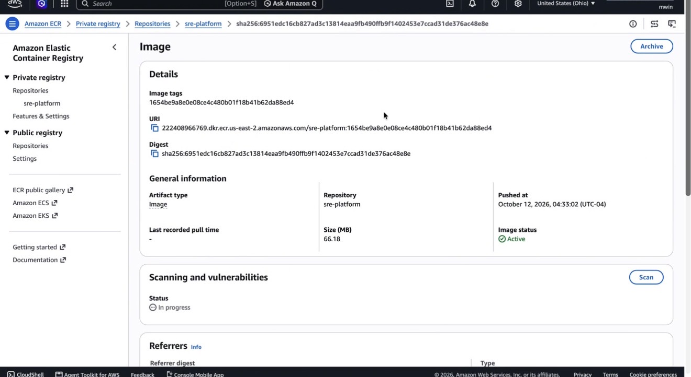

**AWS Systems Manager — Successful deployment, exit code 0**

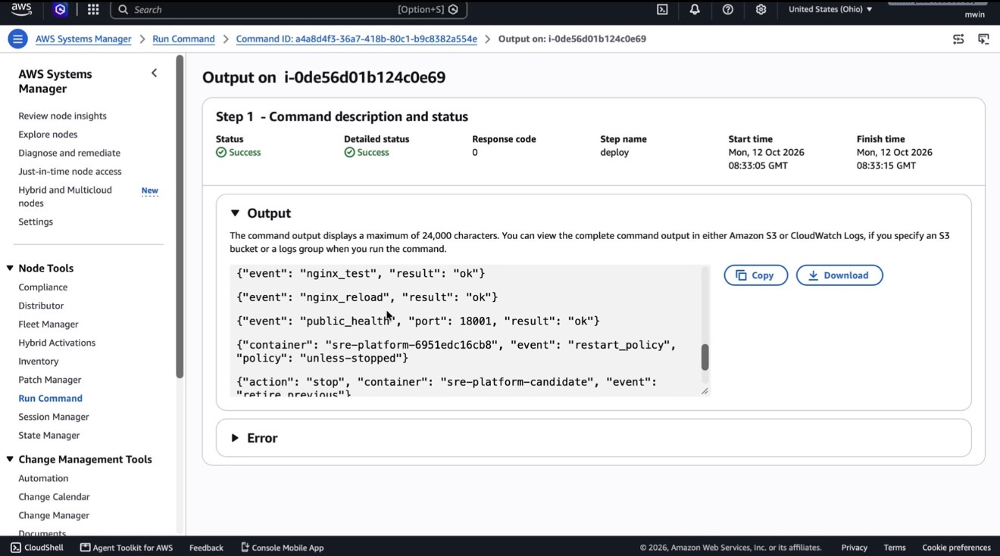

### Failure Detection & Alerting

A controlled application outage triggered CloudWatch and Datadog monitoring alerts. Datadog recorded HTTP 502 responses from the public health endpoint.

**CloudWatch — Failure alarm triggered**

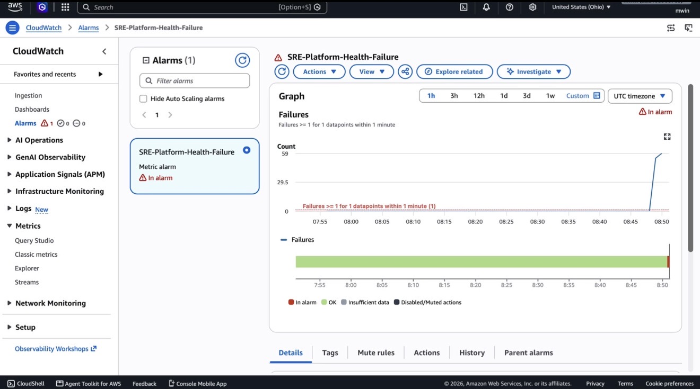

**Datadog — External HTTP 502 failure**

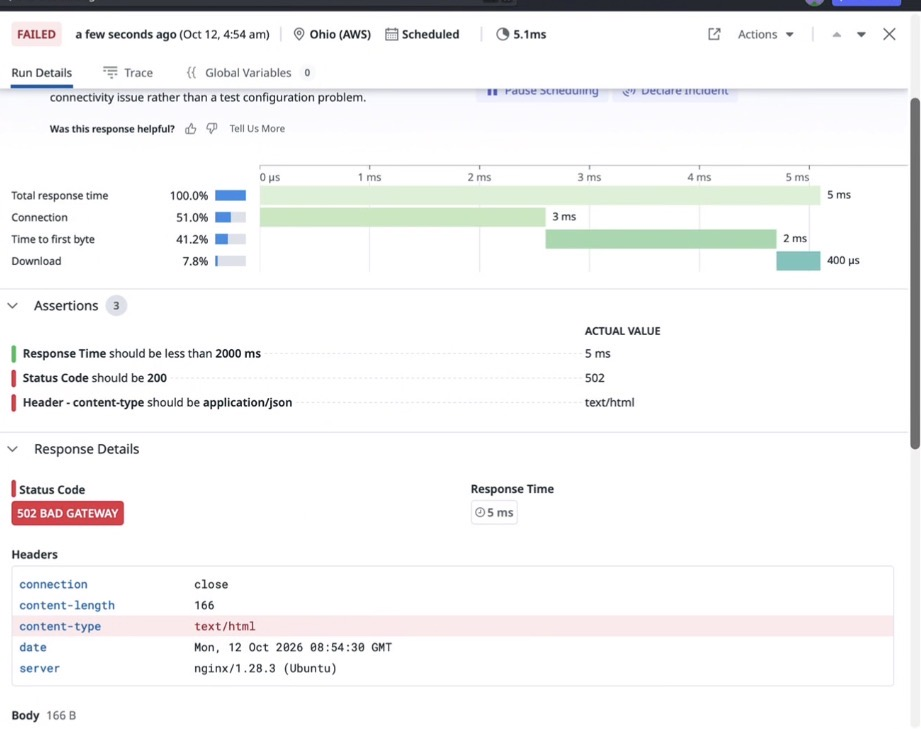

**Datadog — ALERT state**

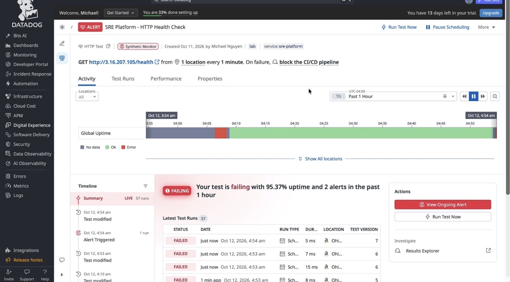

**Datadog — Alert email delivered**

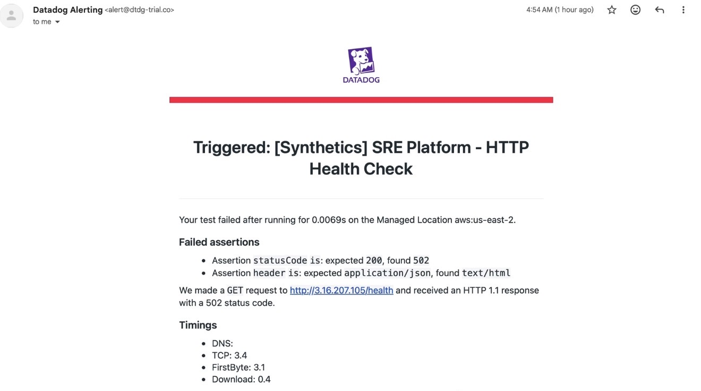

### Manual Recovery & Verification

After manually restoring the application, the external synthetic checks recovered and Datadog delivered a recovery notification.

**Datadog — Recovered to OK**

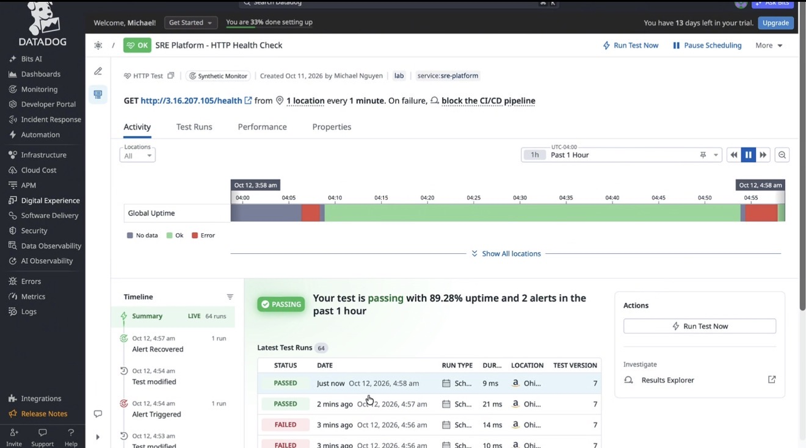

**Datadog — HTTP 200 verification**

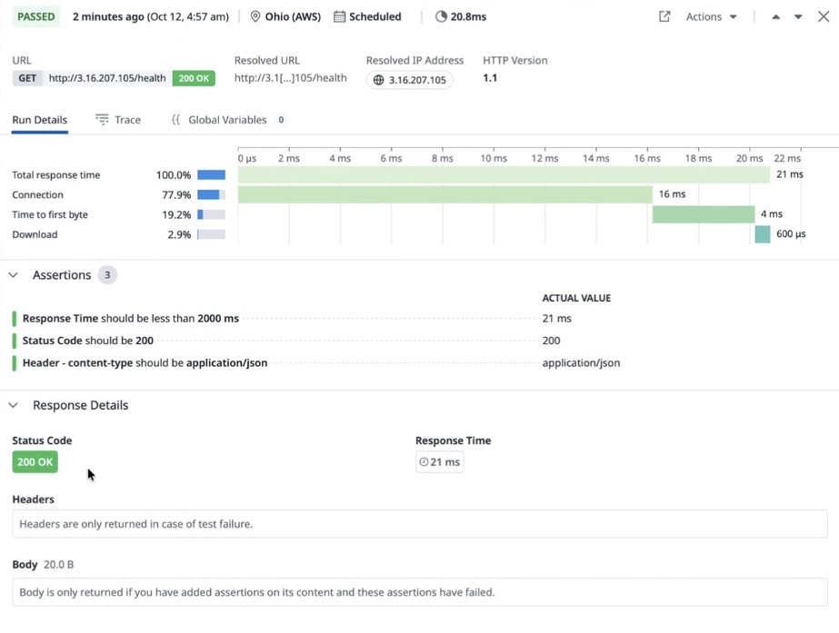

**Datadog — Recovery email delivered**

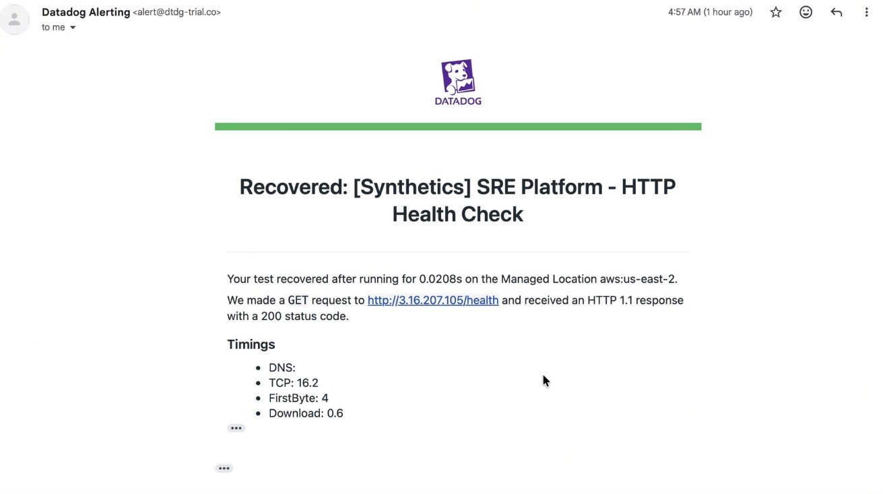

**Recovery distinction:** Runtime recovery was performed manually. Automated deployment rollback safeguards were implemented and unit-tested but were not live-verified.
